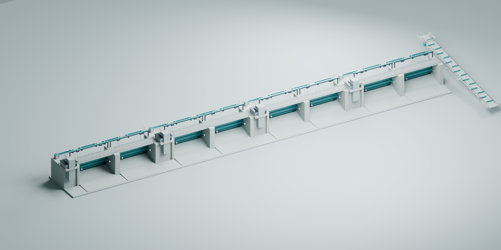
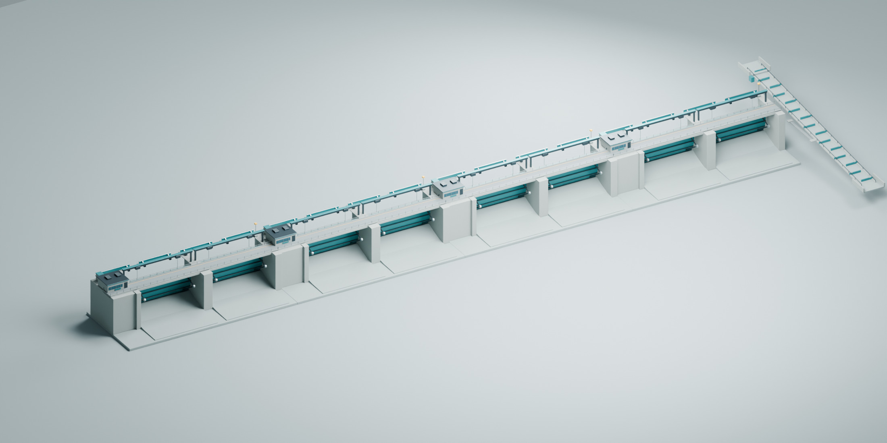

# Mun River Power 0.17.6

Add 34 MW of installed turbine capacity for every complete 75 m of dam: 150 m = 68 MW, 300 m = 136 MW, and 375 m = 170 MW. The 75 m interval is a mod layout assumption derived from 300/4; it is not a confirmed real turbine spacing.

Construction cost and upkeep equal the original dam's values at the same length and height multiplied by `min(1, mod rating / original dam rating)`. For example, 136/272 MW costs 50% as much in both categories. The calculation uses installed capacity, regardless of current water flow or output. An incomplete 75 m interval adds no capacity. A dam shorter than 75 m has no turbines but still incurs the original civil works cost.

## Preview

*300 m dam model. This is a Blender render, not an in-game screenshot.*

*Model preview with upgrades installed; placement and appearance in the game still need verification.*

## Installation

Close the game, extract `MunRiverPower-0.17.6.zip`, and run `Install.cmd`. Check that the version is `0.17.6.0`. Open a test city and let the simulation run. Existing mod powerhouses recalculate their capacity from their actual length. Vanilla dams are unaffected.

The placement tool now uses the mod's prefab. For mod dam segments, the original concrete wall mesh is removed from the visual composition. Because that also removes the original road surface, the mod draws its own road surface, curbs, and lane markings. Version 0.17.3 used the game's road material on custom meshes, which caused visual distortion. This version uses HDRP Lit without mesh deformation and adjusts the color to resemble the connected game road. The game's road network still handles connections, traffic, and removal. The appearance still needs in-game verification.

Each upkeep ratio has a private mod profile stored in `%USERPROFILE%/AppData/LocalLow/Colossal Order/Cities Skylines II/ModsData/MunRiverPower/economic-profiles.json`. **Back up `ModsData/MunRiverPower` with your save, especially when moving to another computer.** Do not delete it while using a city created with this version.

## Automatic Spillway

Version 0.17.6 moves the entire spillway assembly clear of the vehicle lane, leaving at least 0.65 m between the model edge and the lane edge. The building-attached upgrade pieces are shifted another 5 m toward the side of the dam. The road color has also been adjusted to better match the connected game road. These changes need visual verification in the game.

- Releases water when freeboard drops to 0.5 m or less and stops when it returns to about 1.0 m. Separate opening and closing thresholds prevent rapid toggling, and release tapers near the target.
- Sends paired removal and addition commands from the reservoir to the downstream side. It adds no turbine capacity and does not change sea level or create a permanent water source.
- Waits when downstream water is too high or the intake/outlet is not wet enough. Disabling the upgrade stops the extra release commands.
- Experimental price: ₡100,000 plus ₡1,000/month upkeep. One internal building upgrade per powerhouse, with a custom 3D gate model.
- Freeboard is an estimate based on the simulated crest and water surface. The display has 0.1 m precision from -5 to 20 m and shows an out-of-range message beyond that. Foundation depth and MW capacity are not water-distance measures.

**The control rules and API commands have been checked, but actual water movement, status display, and save loading have not yet been tested in-game.** Start with a copy of a city and follow [TESTING.md](TESTING.md). Removal and addition commands use equal values, but the game's water simulation may still introduce differences, for example through clamping in shallow water or at map edges.

## Fish Passage

Open the information panel for an existing Mun River Powerhouse, choose Fish Passage, and confirm the upgrade on that powerhouse. One can be installed per powerhouse, including older mod buildings and buildings with different upkeep ratios.

- Well-being +2 and a 4,000 m radius at 100% efficiency. The effect uses an absolute value, not 2% of happiness.
- The game's area effect is strongest near the powerhouse and falls to zero at the radius boundary. It does not give every household +2. Powerhouse efficiency can modify both strength and radius under the game's normal rules.
- Experimental installation cost ₡25,000 and additional upkeep ₡500/month are game balance values, not real-world cost estimates.
- This is an internal building upgrade through the game menu, with a custom 3D fish passage model. It adds no turbines or installed capacity.
- Disabling or removing the upgrade should remove its area effect according to game rules. The normal upgrade system records its installation.

## Testing status

The build and API references for game version 1.6.2f1 pass. The user tested model visuals in an earlier version. Version 0.17.6 still needs in-game checks of spillway placement and road color; use [TESTING.md](TESTING.md) to check actual charges, placement, and save loading.

- The game's road and collision systems remain in use. The 75 m visual modules follow the mod dam line. The Pak Mun reference height of 17 m from the foundation is not the operating water head.
- Generation requires at least 3 m of water head. Flow and operating efficiency determine actual output. Assumed turbine efficiency is 90%.
- Turbines are counted numerically; individual turbine models are not yet added or removed during dragging.
- The preview shows estimated generation and installed capacity for the turbine count. For example, 401 m gives five turbines and 170 MW; digging deeper does not raise the generation side above the rating. Water and efficiency may change after construction. The placement price follows the game's actual cost calculation.
- The price adjustment is for game balance and does not represent construction costs in Thailand.

See [SPECIFICATION.md](SPECIFICATION.md) for details. Use `Collect-Diagnostics.ps1` to collect information about a problem.

## Development

Use Windows, .NET SDK 10.0.401, and a Cities: Skylines II installation matching the API references. Run `./Build.ps1 -GamePath 'F:\Cities Skylines II'` with your local game path, then `./tools/Verify-Package.ps1 -GamePath 'F:\Cities Skylines II'` to check `dist/MunRiverPower`. Run the calculation checks with `dotnet run --project tests/PlacementLedgerChecks/PlacementLedgerChecks.csproj -c Release`.

Blender model sources and GLB exports are in `assets/ModernDam/`, with the generation script at `tools/create_modern_dam.py`. The latest ZIP is in `releases/`. Build output, caches, and test reports are excluded from Git.
